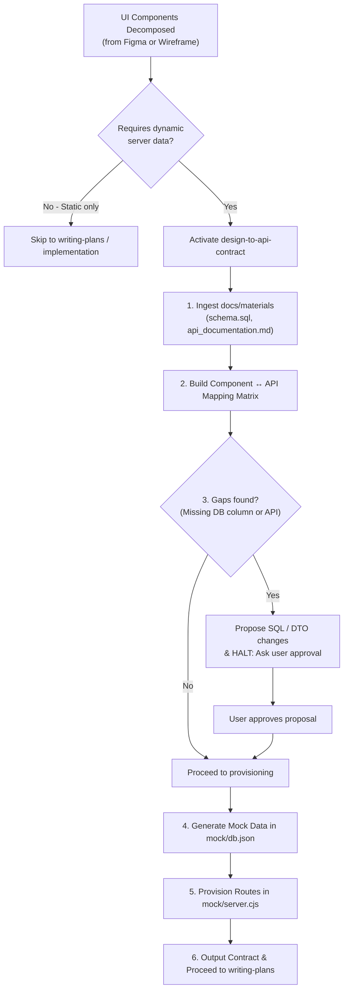

# Design to API Contract & Mock Server Provisioning

Inspect decomposed React components from UI designs, map their dynamic data requirements against project documentation (`docs/materials/api_documentation.md`, `schema.sql`, `domain_enums_documentation.md`), halt on schema gaps to get user confirmation, and provision realistic data and endpoints in the project's mock server (`mock/server.cjs`, `mock/db.json`).

> **Workflow Sequence:**
> `figma-to-components` / `image-to-components` ➔ **`design-to-api-contract`** ➔ `writing-plans` ➔ `executing-plans`

---

## When to Use



### Trigger when:
- You have decomposed a screen or feature into components and need to identify which endpoints supply their data.
- You need to determine whether the existing backend schema (`schema.sql`) and API contracts (`api_documentation.md`) fulfill all UI data requirements.
- You need to create realistic mock data and endpoints in `mock/server.cjs` and `mock/db.json` so frontend features can run locally via `npm run dev:mock`.

### When NOT to use:
- Components are purely presentational or static (e.g., static marketing copy, typography wrappers, icon pills).
- Refactoring internal component CSS or layout without touching props or data contracts.

---

## Step-by-Step Workflow

### Phase 1: Ingest Reference Materials

Read all canonical specification files located in `docs/materials/`:

1. **`docs/materials/api_documentation.md`**:
   - Check canonical endpoint paths, HTTP verbs (`GET`, `POST`, `PUT`, `PATCH`, `DELETE`).
   - Inspect request payloads and response DTO shapes.
   - Note pagination parameters (`page`, `size`, `sort`) and response formats (`PageResponse<T>`).
2. **`docs/materials/schema.sql`**:
   - Check table names, column types, foreign key relationships (`REFERENCES`), nullability (`NOT NULL`), and default values.
3. **`docs/materials/domain_enums_documentation.md`**:
   - Validate that all entity status values, categories, and role names match domain enums (e.g., `EventStatus`, `RegistrationStatus`, `UserRole`, `PointCategory`).
4. **`docs/materials/seed_*.sql`**:
   - Verify canonical IDs for predefined criteria and categories.

---

### Phase 2: Component ↔ API Mapping Matrix

For every component requiring dynamic state, build an explicit mapping table:

| Component Name | File Placement | Action | Target Endpoint & Verb | Expected DTO / Model |
| :--- | :--- | :--- | :--- | :--- |
| `<ComponentName>` | `src/features/<feature>/components/...` | READ / MUTATE | `GET /events/:id` | `EventDetailResponse` |

#### Architectural Mapping Guidelines:
- **Container / Page Component:** Owns `@tanstack/react-query` hooks (`useQuery` / `useMutation`) via feature services (`src/features/<feature>/services/<name>Service.ts`).
- **Presentational Sub-component:** Receives typed props or reads query cache; never performs ad-hoc fetch calls.
- **Dynamic URL Parameters:** Dynamic route values (e.g., `/events/:id`) must be retrieved via `useParams()` or `useSearchParams()`. Never hardcode static IDs in fetch calls.

---

### Phase 3: Gap Analysis & Mandatory Human Gate

Compare UI requirements against `api_documentation.md` and `schema.sql`.

#### 3.1 Gap Classification
- **Type A: Frontend Calculated (No backend change):** Value derived on client (e.g., progress percentage `(current / max) * 100`).
- **Type B: Missing DTO Field (Table already has the column):** The database table contains the column, but the API DTO does not expose it in the response.
- **Type C: Missing Column / Table (Database schema modification needed):** The UI requires saving or displaying new attributes not currently stored.

#### 3.2 Human Gate Protocol
<HARD-GATE>
If any **Type B (DTO change)**, **Type C (Database schema change)**, or **completely new API endpoint** is identified:

1. Draft the formal proposal detailing:
   - Specific table name and proposed column name, data type, and constraints.
   - Precise SQL migration snippet (e.g., `ALTER TABLE events ADD COLUMN ...`).
   - DTO request/response payload alterations.
   - UI justification (which component displays or submits this field).
2. **HALT EXECUTION IMMEDIATELY.** Ask the user:
   > *"I have detected missing fields/endpoints needed for this UI. Please review and approve this schema & API proposal before I provision mock data and endpoints."*
3. **DO NOT** edit `mock/server.cjs` or `mock/db.json` until the user explicitly confirms the proposal.
</HARD-GATE>

---

### Phase 4: Mock Data Generation in `mock/db.json`

Once approved (or if no gaps existed), add realistic, domain-accurate Vietnamese test records to `mock/db.json`:

1. **CTU University Domain Standards:**
   - Emails: `@student.ctu.edu.vn` (students) or `@ctu.edu.vn` (staff/organizers).
   - Student IDs (MSSV): e.g., `B2303827`, `B21DCCN001`.
   - Campuses & Venues: e.g., `Hội trường Rùa`, `Nhà học C1`, `Khu II, Đại học Cần Thơ`.
   - Faculty Names: e.g., `Trường Công nghệ Thông tin & Truyền thông`, `Khoa Khoa học Tự nhiên`.
2. **Relational Integrity:**
   - Ensure foreign keys resolve to real records (e.g., `eventId` in `registrations` points to an existing item in `events`).
3. **Enum Adherence:**
   - Use only valid enum constants from `domain_enums_documentation.md`.

---

### Phase 5: Mock Server Endpoint Provisioning in `mock/server.cjs`

The project mock server (`mock/server.cjs`) uses Express + `json-server`. Any new route must strictly follow the project envelope conventions.

#### 5.1 Project Envelope Standards

**Single Entity / Mutation Success Envelope:**
```javascript
res.json(successEnvelope(data, 'Thao tác thành công'))
// Output: { data: ..., message: 'Thao tác thành công', exceptionCode: null }
```

**Paginated Spring PageResponse Envelope (`makePageResponse`):**
```javascript
const items = db.get('events').value()
res.json(makePageResponse(items, req.query.page, req.query.size))
// Output matches Spring Page<T>: { content: [...], totalElements: ..., totalPages: ..., ... }
```

**Error Envelope:**
```javascript
res.status(400).json(errorEnvelope('Mô tả lỗi cụ thể', 'VALIDATION_ERROR'))
// Output: { data: null, message: '...', exceptionCode: 'VALIDATION_ERROR' }
```

**Current User Resolution:**
```javascript
const currentUserId = getCurrentUserIdFromRequest(req)
```

#### 5.2 Provisioning Instructions
1. Check if the endpoint already exists in `mock/server.cjs`.
2. If absent, add the route handler to `apiRouter` before `server.use('/api', apiRouter)`.
3. If new entities are required, initialize their collection array in `mock/db.json`.
4. Validate mock server syntax immediately by running `node -c mock/server.cjs` to prevent runtime crashes.

---

### Phase 6: Contract Specification Output

Present the final specification summary to the user:

```markdown
## Component ↔ API Contract: <Screen / Feature Name>

### 1. Component Mapping Matrix
| Component | Required Data Props | Endpoint | Method | DTO Shape |
|---|---|---|---|---|
| ... | ... | ... | ... | ... |

### 2. Schema Gap Decisions (Approved)
- **Database Migrations:** `<ALTER TABLE sql or None>`
- **DTO Enhancements:** `<Field descriptions>`

### 3. Mock Server Provisioning
- **Endpoints added to mock/server.cjs:** `<METHOD> /api/...`
- **Collections updated in mock/db.json:** `<collection_name>`

### 4. Verification
- Verified mock route response (status 200 with envelope).
```

Prompt the user:
> *"The API contract and mock server routes are provisioned. Please approve to transition to implementation planning (`writing-plans`)."*

---

## Quick Reference: Project Mock Envelopes

```javascript
// Success
res.json(successEnvelope({ id: 1, name: 'Sự kiện CTU' }))

// Paginated
const list = db.get('events').filter({ status: 'PUBLISHED' }).value()
res.json(makePageResponse(list, req.query.page, req.query.size))

// Client / Auth error
res.status(401).json(errorEnvelope('Phiên đăng nhập đã hết hạn', 'UNAUTHORIZED'))
```

---

## Red Flags — STOP and Halt Immediately

- "The DB column missing is minor, I'll just add it to `mock/server.cjs` without asking." ➔ **VIOLATION.** You must halt at Phase 3 and ask user approval.
- "I'll hardcode mock values in the React component for now and connect API later." ➔ **VIOLATION.** Hardcoding data in UI components is strictly prohibited. Data belongs in `mock/db.json` and must be fetched via standard hooks.
- "I know what the backend should return, so I won't check `docs/materials/api_documentation.md`." ➔ **VIOLATION.** Always ground contracts in project materials.
- "Violating the letter of the rules is violating the spirit of the rules."

---

## Common Rationalizations & Traps

| Shortcut / Trap | Reality & Correction |
| :--- | :--- |
| **"I'll add the new column to mock server and notify user later in the summary"** | **Hard Gate Violation.** Silent schema evolution breaks backend alignment. Stop at Phase 3, present the SQL migration snippet, and wait for explicit confirmation. |
| **"I'll invent a custom endpoint path (e.g. `/my-events`)"** | Re-read `docs/materials/api_documentation.md`. Use official canonical routes (`/registrations/me/history`). Custom paths cause integration failures. |
| **"Returning raw JSON directly in mock handler is faster"** | The frontend `apiClient` expects standard Spring envelope structures (`{ data, message, exceptionCode }` or `makePageResponse`). Raw JSON will cause parsing errors. |
| **"Fallback mock constants in React components are harmless"** | Fallback mocks hide broken endpoints and offline errors. Components must solely consume data from the query layer. |
| **"Hardcoding ID 1 in fetch call is fine for testing"** | Dynamic parameters must always be parsed from URL params (`useParams()`) or query strings (`useSearchParams()`). |
| **"Using placeholder English mock names (e.g. John Doe)"** | Breaks UI design language and search filtering. Always adhere to the Can Tho University (CTU) domain context. |
