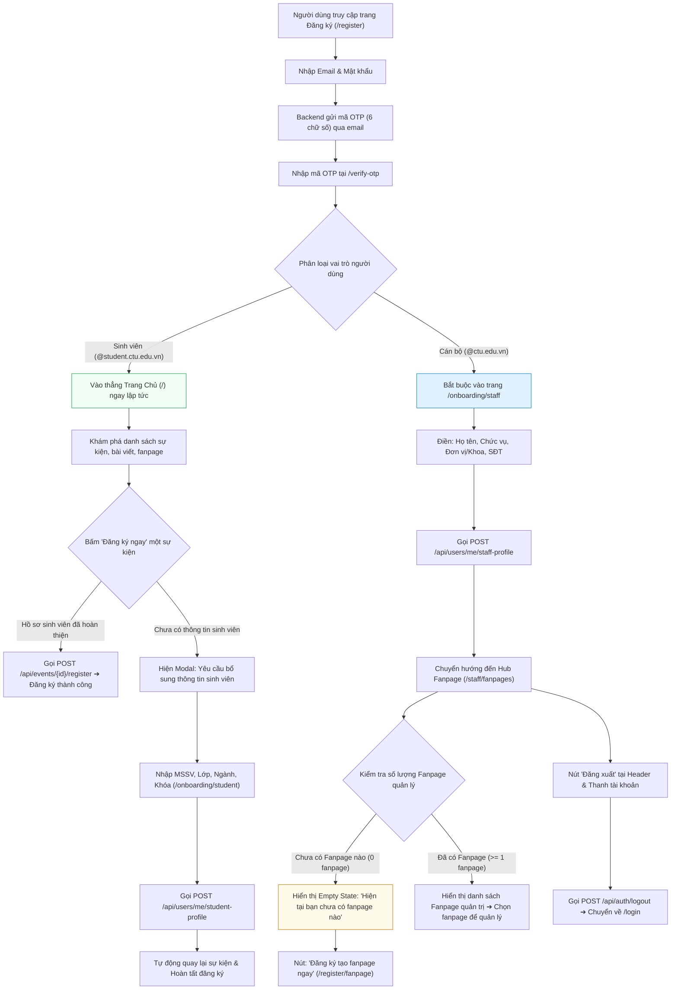
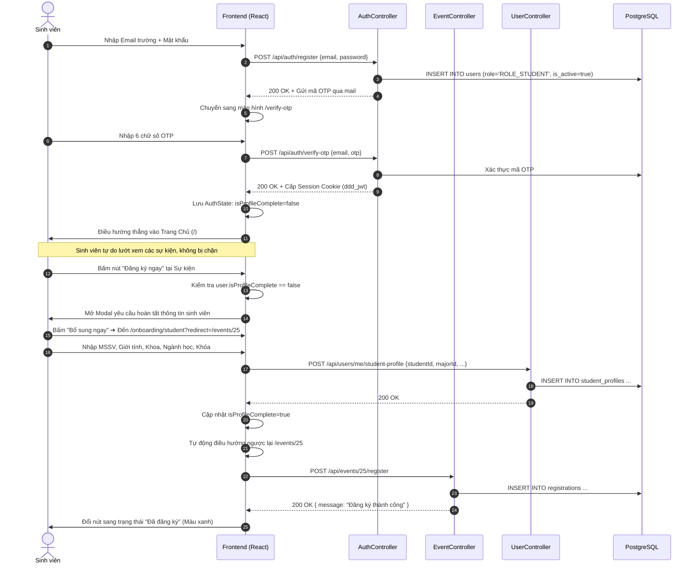
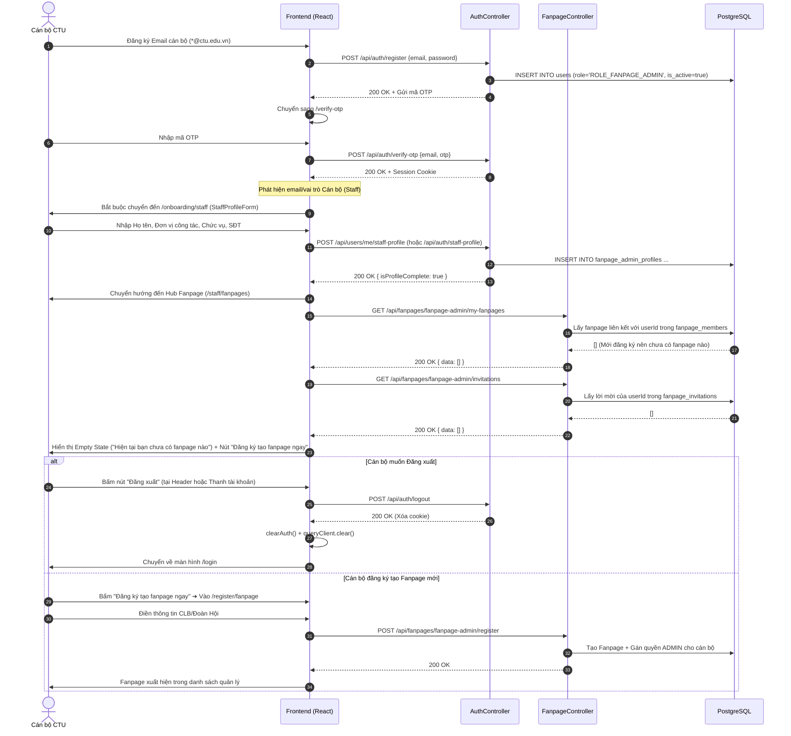

# Registration & Onboarding Flow Specification (Tài liệu Quy trình Đăng ký & Hoàn thiện Hồ sơ)

> **Mục đích tài liệu:**  
> Đặc tả chi tiết cho toàn bộ đội ngũ phát triển (**Frontend React** và **Backend Spring Boot DDD**) về quy trình đăng ký tài khoản, phân nhánh nghiệp vụ theo vai trò người dùng (**Sinh viên** vs **Cán bộ / Quản trị Fanpage**), luồng hoàn thiện hồ sơ sinh viên theo ngữ cảnh (Just-In-Time) và trung tâm quản lý fanpage dành cho cán bộ.

---

## 1. Tổng quan & So sánh hai phân hệ người dùng

Hệ thống phân tách luồng đăng ký dựa trên tiền tố/hậu tố email và vai trò định danh:

| Tiêu chí | Phân hệ Sinh viên (`ROLE_STUDENT`) | Phân hệ Cán bộ (`ROLE_FANPAGE_ADMIN`) |
|:---|:---|:---|
| **Định dạng Email** | `*@student.ctu.edu.vn` (hoặc email cá nhân) | `*@ctu.edu.vn` (hoặc email cán bộ) |
| **Giai đoạn 1: Đăng ký** | Nhập `email` + `mật khẩu` ➔ Nhận mã OTP qua email | Nhập `email` + `mật khẩu` ➔ Nhận mã OTP qua email |
| **Sau khi xác thực OTP** | **Vào thẳng Trang chủ (`/`) ngay lập tức** (chưa cần điền thông tin chi tiết) | **Bắt buộc điền thông tin định danh cán bộ trước** tại `/onboarding/staff` |
| **Thời điểm hoàn thiện hồ sơ** | **Hoãn lại (Deferred / Lazy):** Chỉ yêu cầu khi bấm nút "Đăng ký ngay" ở sự kiện | **Ngay sau khi OTP:** Hoàn thành trước khi vào hệ thống quản lý fanpage |
| **Trang chuyển tiếp sau hồ sơ** | Tự động quay lại sự kiện đang chọn và hoàn tất đăng ký | Chuyển đến **Hub Fanpage Cán bộ (`/staff/fanpages`)** |
| **Trạng thái tài khoản mới** | `isProfileComplete: false`, xem sự kiện bình thường | Chưa có fanpage nào ➔ Hiển thị **Empty State** hướng dẫn tạo fanpage |
| **Đăng xuất (Logout)** | Nút đăng xuất tại Navbar / Menu người dùng | Nút đăng xuất trực tiếp trên Hub Fanpage & Menu tài khoản |

---

## 2. Sơ đồ luồng tổng quan (Architecture Flowchart)



---

## 3. Luồng chi tiết: Sinh viên (Frictionless Student Flow)

### 3.1. Sơ đồ tuần tự (Sequence Diagram)



---

## 4. Luồng chi tiết: Cán bộ / Quản trị Fanpage (Staff Flow)

### 4.1. Sơ đồ tuần tự (Sequence Diagram)



---

## 5. Đặc tả Giao diện & Trạng thái Hub Fanpage (`/staff/fanpages`)

### 5.1. Khi tài khoản cán bộ mới đăng ký (0 Fanpage)
- **Khu vực Lời mời (`pendingInvitations.length === 0`):** Ẩn hoàn toàn, không hiển thị thẻ lời mời thừa.
- **Khu vực Fanpage (`fanpagesList.length === 0`):** Hiển thị khối giao diện Empty State thân thiện:
  - Icon tòa nhà `Building2`.
  - Tiêu đề: **"Hiện tại bạn chưa có fanpage nào"**.
  - Mô tả: *"Tài khoản cán bộ của bạn hiện chưa tham gia hoặc sở hữu fanpage nào. Vui lòng đăng ký để tạo fanpage và bắt đầu tổ chức sự kiện nhé!"*.
  - Nút hành động chính: **[+] Đăng ký tạo fanpage ngay** (dẫn tới `/register/fanpage`).

### 5.2. Tính năng Đăng xuất (Logout) trên Hub Fanpage
Cán bộ có thể chủ động đăng xuất khỏi hệ thống ngay tại trang Hub thông qua:
1. **Nút "Đăng xuất" ở Card Header:** Nằm song song với nút *"Đăng ký fanpage mới"*, viền mỏng, icon `LogOut`, hover hiệu ứng đỏ nhạt.
2. **Thanh thông tin tài khoản (Top bar):** Nằm trên cùng của trang, hiển thị họ tên, email đang đăng nhập kèm liên kết đăng xuất nhanh.
3. **Quy trình xử lý khi nhấn Đăng xuất:**
   - Gửi yêu cầu `POST /api/auth/logout` để backend hủy phiên làm việc.
   - Xóa toàn bộ bộ nhớ đệm TanStack Query (`queryClient.clear()`).
   - Xóa sạch state người dùng và token trong bộ nhớ cục bộ (`clearAuth()`).
   - Điều hướng người dùng về trang đăng nhập `/login`.

---

## 6. Đặc tả Kỹ thuật API (API Contracts)

### 6.1. Đăng ký tài khoản nhanh
- **Endpoint:** `POST /api/auth/register`
- **Quyền hạn:** Công khai (`PermitAll`)
- **Request Body:**
  ```json
  {
    "email": "canbo.cntt@ctu.edu.vn",
    "password": "Password123!"
  }
  ```
- **Response (200 OK):**
  ```json
  {
    "data": {
      "success": true,
      "email": "canbo.cntt@ctu.edu.vn"
    },
    "message": "Đăng ký tài khoản thành công. Mã OTP đã được gửi đến email.",
    "exceptionCode": null
  }
  ```

### 6.2. Xác thực mã OTP
- **Endpoint:** `POST /api/auth/verify-otp`
- **Request Body:**
  ```json
  {
    "email": "canbo.cntt@ctu.edu.vn",
    "otp": "123456"
  }
  ```
- **Response (200 OK):** Thiết lập `Set-Cookie: ddd_jwt=...; HttpOnly; Path=/` và trả về thông tin người dùng ban đầu.

### 6.3. Hoàn thiện hồ sơ sinh viên (Chỉ gọi khi sinh viên đăng ký sự kiện)
- **Endpoint:** `POST /api/users/me/student-profile` (hoặc `POST /api/auth/student-profile`)
- **Quyền hạn:** `ROLE_STUDENT` (Yêu cầu đăng nhập)
- **Request Body:**
  ```json
  {
    "firstName": "Tài Lộc",
    "lastName": "Đoàn",
    "studentId": "B2101234",
    "gender": "MALE",
    "kNumber": 49,
    "majorId": 1,
    "associationId": 2
  }
  ```
- **Response (200 OK):** Cập nhật `isProfileComplete: true`.

### 6.4. Hoàn thiện hồ sơ cán bộ (Gọi ngay sau khi cán bộ xác thực OTP)
- **Endpoint:** `POST /api/users/me/staff-profile` (hoặc `POST /api/auth/staff-profile`)
- **Quyền hạn:** `ROLE_FANPAGE_ADMIN` (Yêu cầu đăng nhập)
- **Request Body:**
  ```json
  {
    "firstName": "Hoàng",
    "lastName": "Lê Văn",
    "phoneNumber": "02923832663",
    "gender": "MALE",
    "staffCode": "CB04921",
    "position": "Phó Bí thư Đoàn Trường",
    "department": "Trường CNTT & TT"
  }
  ```
- **Response (200 OK):** Cập nhật thông tin cán bộ, trả về `isProfileComplete: true`.

### 6.5. Lấy danh sách Fanpage đang quản lý
- **Endpoint:** `GET /api/fanpages/fanpage-admin/my-fanpages`
- **Quyền hạn:** `ROLE_FANPAGE_ADMIN`
- **Xử lý phía Backend:**
  - Lấy `email` hoặc `userId` từ token (`SecurityContextHolder`).
  - Truy vấn các fanpage mà người dùng có quan hệ hoạt động (`isActive = true`) trong bảng `fanpage_members`.
  - **Với tài khoản cán bộ mới:** Trả về danh sách rỗng `[]` (Tuyệt đối không trả về toàn bộ fanpage hệ thống).
- **Response (200 OK):**
  ```json
  {
    "data": [],
    "message": "Success",
    "exceptionCode": null
  }
  ```

### 6.6. Đăng xuất khỏi hệ thống
- **Endpoint:** `POST /api/auth/logout`
- **Quyền hạn:** Yêu cầu đăng nhập
- **Response (200 OK):** Xoá cookie phiên `ddd_jwt`, `ddd_refresh`.

---

## 7. Bảng mã lỗi quy ước (Exception Codes)

| HTTP Status | Exception Code | Tình huống phát sinh | Cách xử lý phía Frontend |
|:---|:---|:---|:---|
| **403 / 400** | `STUDENT_PROFILE_REQUIRED` | Sinh viên chưa có hồ sơ khi gửi `POST /api/events/{id}/register` | Mở popup yêu cầu bổ sung thông tin sinh viên |
| **401** | `UNAUTHORIZED` | Phiên làm việc hết hạn hoặc chưa đăng nhập | Điều hướng về `/login?redirect=...` |
| **409** | `DUPLICATE_REGISTRATION` | Đã đăng ký sự kiện này trước đó | Hiển thị trạng thái "Đã đăng ký" |
| **400** | `EVENT_FULL` | Sự kiện đã đủ số lượng đăng ký | Vô hiệu hóa nút đăng ký |
| **404** | `FANPAGE_NOT_FOUND` | Không tìm thấy fanpage yêu cầu | Hiển thị thông báo không tìm thấy fanpage |

---

## 8. Tóm tắt lợi ích đạt được

1. **Sinh viên:** Trải nghiệm tức thì, không bị rào cản form biểu mẫu dài dòng làm nản lòng; chỉ nhập thông tin khi có nhu cầu tham gia nhận điểm rèn luyện.
2. **Cán bộ:** Quản lý tập trung, quy trình chặt chẽ với form định danh ban đầu, giao diện quản lý fanpage rõ ràng, có trạng thái khởi tạo hỗ trợ tạo fanpage mới và chức năng đăng xuất thuận tiện.
3. **Hệ thống & Dữ liệu:** Đảm bảo toàn vẹn dữ liệu cho từng fanpage, tính riêng tư và phân quyền chính xác giữa các tài khoản cán bộ.
