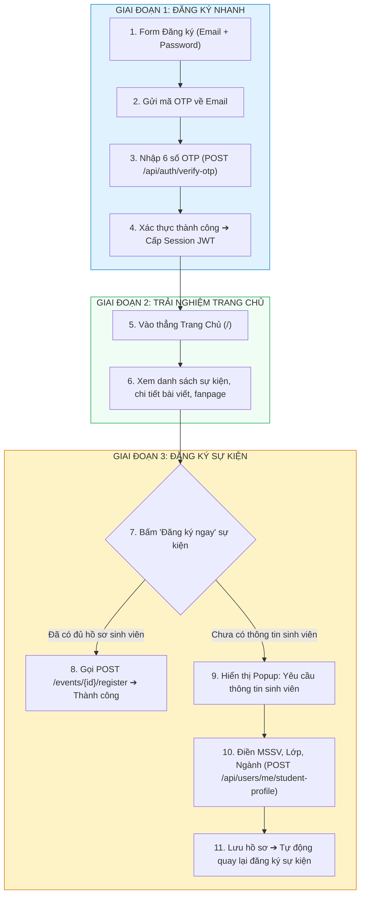
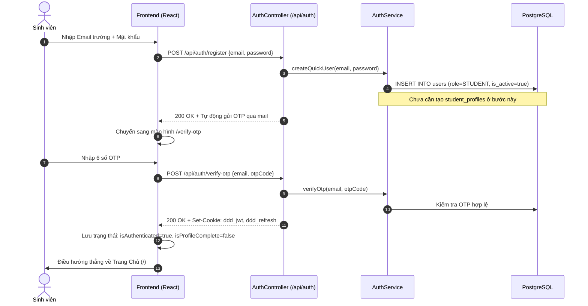
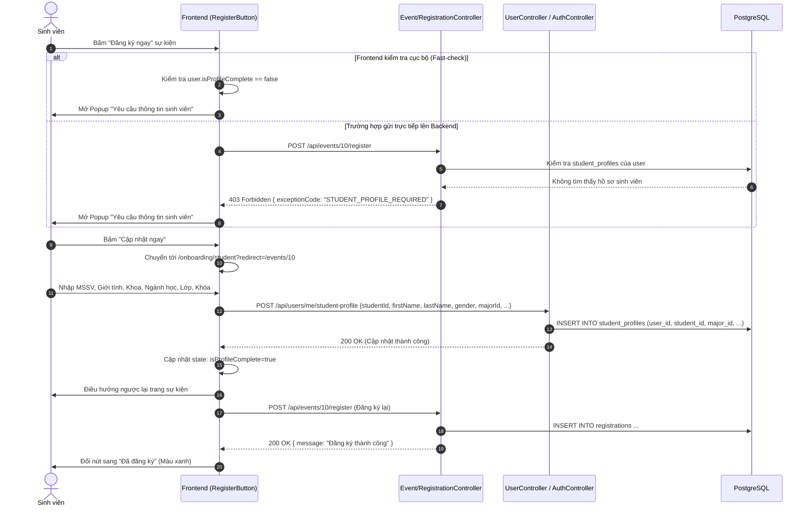

# Deferred Student Onboarding & Event Registration Flow (Tài liệu Tách Luồng Đăng Ký và Hoàn Thiện Hồ Sơ)

> **Mục đích tài liệu:**  
> Giải thích chi tiết cho đội ngũ **Backend (Spring Boot DDD)** về kiến trúc và luồng nghiệp vụ mới từ **Frontend**: Tối ưu hóa trải nghiệm đăng ký (Frictionless Onboarding), cho phép sinh viên vào trang chủ ngay sau khi xác thực OTP, và chỉ yêu cầu điền thông tin chi tiết sinh viên khi bấm đăng ký sự kiện.

---

## 1. Bối cảnh & Vấn đề giải quyết

### 1.1. Luồng cũ (Tạo ma sát lớn - High Friction)
- Người dùng đăng ký phải nhập cùng lúc: `email`, `password`, `studentId`, `firstName`, `lastName`, `gender`, `kNumber`, `majorId`, `associationId`, `providerId`.
- Nếu thiếu bất kỳ trường nào, Backend từ chối với lỗi `400 Bad Request`.
- Người dùng chưa kịp nhìn thấy sự kiện nào trên web đã phải điền quá nhiều thông tin ➔ Dẫn đến tỷ lệ bỏ dở đăng ký cao (High Drop-off rate).

### 1.2. Luồng mới (Just-In-Time / Lazy Onboarding)
- **Giai đoạn 1 (Đăng ký nhanh):** Người dùng chỉ cần cung cấp `email` + `password` và xác thực mã `OTP` gửi về email. Sau khi xác thực xong, hệ thống đăng nhập và chuyển thẳng vào **Trang chủ (`/`)** để lướt xem các sự kiện và bài viết.
- **Giai đoạn 2 (Hoàn thiện hồ sơ theo ngữ cảnh):** Chỉ khi người dùng bấm nút **"Đăng ký ngay"** ở một sự kiện, hệ thống mới kiểm tra và yêu cầu người dùng bổ sung thông tin sinh viên (MSSV, ngành, khóa,...) để phục vụ tính điểm rèn luyện.

---

## 2. Sơ đồ luồng tổng quan (Architecture Flowchart)



---

## 3. Sơ đồ tuần tự chi tiết (Sequence Diagrams)

### 3.1. Giai đoạn 1: Đăng ký & Xác thực OTP nhanh



---

### 3.2. Giai đoạn 2 & 3: Đăng ký sự kiện & Hoàn thiện hồ sơ



---

## 4. Đề xuất điều chỉnh Backend (Backend Action Items)

Để hỗ trợ hoàn hảo luồng này, phía Backend (Spring Boot DDD) cần điều chỉnh hoặc bổ sung các điểm sau:

### 4.1. Cho phép Đăng ký nhanh chỉ với Email + Password
- **Endpoint:** `POST /api/auth/register` (hoặc tạo thêm `POST /api/auth/register-quick`)
- **Request Body tối thiểu:**
  ```json
  {
    "email": "student123@student.ctu.edu.vn",
    "password": "Password123!"
  }
  ```
- **Xử lý:**
  - Tạo bản ghi trong bảng `users` với role `ROLE_STUDENT`.
  - Chưa bắt buộc phải có `student_profiles` ngay, hoặc cho phép các trường profile nhận `null` tạm thời.

---

### 4.2. Bổ sung Endpoint Lưu/Hoàn thiện hồ sơ sinh viên
- **Endpoint:** `POST /api/users/me/student-profile` hoặc `POST /api/auth/student-profile`
- **Security:** Yêu cầu đăng nhập (`Authenticated` qua JWT cookie).
- **Request Body:**
  ```json
  {
    "firstName": "Văn A",
    "lastName": "Nguyễn",
    "studentId": "B2101234",
    "gender": "MALE",
    "kNumber": 49,
    "majorId": 1,
    "associationId": 1
  }
  ```
- **Xử lý:**
  - Lấy `userId` từ token đang đăng nhập (`SecurityContextHolder`).
  - Lưu bản ghi vào bảng `student_profiles` liên kết với `userId`.
  - Trả về `BaseResponse.ok()`.

---

### 4.3. Kiểm tra điều kiện khi Đăng ký sự kiện
- **Endpoint:** `POST /api/events/{id}/register` hoặc `POST /api/registrations`
- **Xử lý:**
  - Trước khi ghi nhận vào bảng `registrations`, kiểm tra xem tài khoản sinh viên đã có `student_profiles` hợp lệ hay chưa.
  - **Nếu chưa có:** Trả về lỗi có mã định danh rõ ràng:
    ```json
    {
      "data": null,
      "message": "Vui lòng hoàn thiện thông tin sinh viên trước khi đăng ký sự kiện.",
      "exceptionCode": "STUDENT_PROFILE_REQUIRED"
    }
    ```
    *HTTP Status:* `400 Bad Request` hoặc `403 Forbidden`.

---

## 5. Danh mục mã lỗi (Exception Codes quy ước)

| HTTP Status | Exception Code | Ý nghĩa | Frontend xử lý |
|:---|:---|:---|:---|
| **403 / 400** | `STUDENT_PROFILE_REQUIRED` | Người dùng chưa có thông tin sinh viên khi đăng ký sự kiện | Mở modal chuyển hướng sang form hoàn thiện hồ sơ sinh viên |
| **401** | `UNAUTHORIZED` | Chưa đăng nhập | Chuyển hướng sang `/login?redirect=...` |
| **409** | `DUPLICATE_REGISTRATION` | Sinh viên đã đăng ký sự kiện này rồi | Hiển thị nút "Đã đăng ký" |
| **400** | `EVENT_FULL` | Sự kiện đã hết số lượng đăng ký | Vô hiệu hóa nút đăng ký |

---

## 6. Lợi ích của luồng mới
1. **Tăng tỷ lệ chuyển đổi (Conversion Rate):** Sinh viên tạo tài khoản chỉ mất dưới 30 giây để bắt đầu khám phá hệ thống.
2. **Đúng ngữ cảnh (Contextual Need):** Chỉ yêu cầu nhập MSSV, chi hội, ngành học khi thực sự cần thiết (lúc đăng ký sự kiện để cấp chứng nhận và điểm rèn luyện).
3. **Trải nghiệm mượt mà:** Sau khi nhập thông tin ở sự kiện A, hệ thống tự động đưa sinh viên trở lại sự kiện A và tiếp tục đăng ký mà không cần tìm lại sự kiện.
